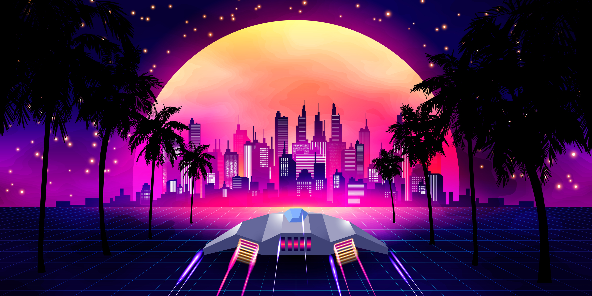

# On-The-Fly Media Optimization and Dynamic Image Manipulation

### Auto Image Optimization - Default Output

Zesty.io automatically transforms images as the content-type "webp", which is a format made to  optimized image download speed and rendering speed, developed by Google.

> &#x20;WebP is a modern **image format** that provides superior **lossless and lossy** compression for images on the web. Using WebP, webmasters and web developers can create smaller, richer images that make the web faster. - _Read the full Google launch article_ [_https://developers.google.com/speed/webp_](https://developers.google.com/speed/webp)

&#x20;When optimization happens, Zesty.io does a few things to the file:

* All metadata (for example, EXIF, XMP, or ICC) will is removed.
* Any [ICC profile](https://en.wikipedia.org/wiki/ICC\_profile) on the image is applied directly to the image to ensure color output is correct. If the image doesn't have an ICC profile, a default profile is added.
* If the source image contains orientation metadata, this orientation will be applied directly to the image data and metadata will be removed.
* Images are served with their original name and extension, but will still output as `content-type` "webp"&#x20;

### OTF DAM Quick Examples

```markup
<!-- using the direct media url, append query parameters to the url --> 

<!-- using parsley, append query paramters outside th call -->


<!-- example using src set images to be used at different display pixel densities -->

     
<!-- HTML5 art direction, use different images based on browser width -->
<picture>
  <source srcset="{{this.image.getImage()}}?width=600&crop=16:9" media="(min-width: 600px)"/>
  
</picture>

<style>
  .header {
    background-image: url(https://9skdl6.media.zestyio.com/Arcade-Space-Ship-Example.jpg?width=2000)
  }
</style>
```

### Bypass Image Optimization&#x20;

To bypass image optimization to get the raw encoding and data of the origin image, append `?raw=true` to the end of the image request like so:

`https://9skdl6.media.zestyio.com/Arcade-Space-Ship-Example.jpg?raw=true`

This is useful for fetching EXIF data or other meta data hidden in your image file.

### Image Manipulation Options

All image may be manipulated on-the-fly by passing query parameter to the end of the image URL. See the example below

| Query Param    | Example                                                                                                                                                  |
| -------------- | -------------------------------------------------------------------------------------------------------------------------------------------------------- |
| **none**       | [https://9skdl6.media.zestyio.com/Arcade-Space-Ship-Example.jpg](https://9skdl6.media.zestyio.com/Arcade-Space-Ship-Example.jpg)                         |
| **?width=**    | [https://9skdl6.media.zestyio.com/Arcade-Space-Ship-Example.jpg?width=300](https://9skdl6.media.zestyio.com/Arcade-Space-Ship-Example.jpg?width=300)     |
| **?orient=**   | [https://9skdl6.media.zestyio.com/Arcade-Space-Ship-Example.jpg?orient=v](https://9skdl6.media.zestyio.com/Arcade-Space-Ship-Example.jpg?orient=v)       |
| **?bg-color=** | [https://9skdl6.media.zestyio.com/parsley-logo-brackets.png?bg-color=006699](https://9skdl6.media.zestyio.com/parsley-logo-brackets.png?bg-color=006699) |



We recognize the following parameters in the query string of the image request:

| Parameter                                                                                                                     | Description                                                                                     |
| ----------------------------------------------------------------------------------------------------------------------------- | ----------------------------------------------------------------------------------------------- |
| [`auto`](on-the-fly-media-optimization-and-dynamic-image-manipulation.md#auto-optimize-image-jpg-auto)                        | Enable optimization features automatically.                                                     |
| [`bg-color`](on-the-fly-media-optimization-and-dynamic-image-manipulation.md#background-color-bg-color)                       | Set the background color of an image.                                                           |
| [`bypass`](on-the-fly-media-optimization-and-dynamic-image-manipulation.md#bypass-image-jpg-raw-true)                         | Ignore all optimization and fetch the raw original image                                        |
| [`blur`](on-the-fly-media-optimization-and-dynamic-image-manipulation.md#gaussian-blur-blur)                                  | Set the blurriness of the output image.                                                         |
| [`brightness`](on-the-fly-media-optimization-and-dynamic-image-manipulation.md#brightness-brightness)                         | Set the brightness of the output image.                                                         |
| [`canvas`](on-the-fly-media-optimization-and-dynamic-image-manipulation.md#canvas)                                            | Increase the size of the canvas around an image.                                                |
| [`contrast`](on-the-fly-media-optimization-and-dynamic-image-manipulation.md#contrast-image-jpg-contrast)                     | Set the contrast of the output image.                                                           |
| [`crop`](https://developer.fastly.com/reference/io/crop)                                                                      | Crop an image by removing pixels from an image based on a ratio. Great for thumbnails.          |
| [`dpr`](on-the-fly-media-optimization-and-dynamic-image-manipulation.md#device-pixel-ratio-dpr-image-jpg-dpr)                 | Device Pixel Ratio - Serve correctly sized images for devices that expose a device pixel ratio. |
| [`fit`](on-the-fly-media-optimization-and-dynamic-image-manipulation.md#fit-image-jpg-fit-cover-and-height-200-and-width-200) | Set how the image will fit within the width and height provided.                                |
| [`height`](on-the-fly-media-optimization-and-dynamic-image-manipulation.md#height-images-jpg-height)                          | Resize the height of the image.                                                                 |
| [`optimize`](on-the-fly-media-optimization-and-dynamic-image-manipulation.md#image-optimize-image-jpg-optimize)               | Automatically apply optimal quality compression.                                                |
| [`orient`](on-the-fly-media-optimization-and-dynamic-image-manipulation.md#orientation-image-jpg-orient)                      | Change the cardinal orientation of the image.                                                   |
| [`pad`](on-the-fly-media-optimization-and-dynamic-image-manipulation.md#image-padding-image-jpg-pad)                          | Add pixels to the edge of an image, like css padding.                                           |
| [`quality`](on-the-fly-media-optimization-and-dynamic-image-manipulation.md#image-quality-image-jpg-quality)                  | Optimize the image to the given compression level for lossy file formatted images.              |
| [`saturation`](on-the-fly-media-optimization-and-dynamic-image-manipulation.md#saturation-image-jpg-saturation)               | Set the saturation of the output image.                                                         |
| [`sharpen`](on-the-fly-media-optimization-and-dynamic-image-manipulation.md#sharpen-image-jpg-sharpen)                        | Set the sharpness of the output image.                                                          |
| [`trim`](on-the-fly-media-optimization-and-dynamic-image-manipulation.md#trim-image-jpg-trim)                                 | Remove pixels from the edge of an image.                                                        |
| [`width`](on-the-fly-media-optimization-and-dynamic-image-manipulation.md#width-image-jpg-width)                              | Resize the width of the image.                                                                  |

### Image Manipulation Processing order

Manipulation query parameters can be specified in any order, but they are processed in this order:

| Order | Query Call                                                 |
| ----- | ---------------------------------------------------------- |
| 1     | `trim`                                                     |
| 2     | `crop`                                                     |
| 3     | `orient`                                                   |
| 4     | `width`     `height`    `dpr`     `fit`                    |
| 5     | `pad`     `canvas`     `bg-color`                          |
| 6     | `brightness`     `contrast`     `saturation`               |
| 7     | `sharpen`                                                  |
| 8     | `blur`                                                     |
| 9     |  `auto`    `optimize`    `quality`    `profile`    `level` |

## Zesty.io OTF DAM: On-The-Fly Image Options API

All query parameters listed below may be used in conjunction with one another, and may be stacked. Some query params conflict with each other, for example [pad](on-the-fly-media-optimization-and-dynamic-image-manipulation.md#image-padding-image-jpg-pad) and [canvas](on-the-fly-media-optimization-and-dynamic-image-manipulation.md#canvas). This behavior is documented under each example API call.

## Auto Optimize:   /image.jpg?auto=

<mark style="color:blue;">`GET`</mark> `https://9skdl6.media.zestyio.com/Arcade-Space-Ship-Example.jpg?auto=webp`

Enables optimizations based on content negotiation. Although the WebP format produces images at a higher compression ratio with a lower loss of quality, it is not supported in all browsers.\
\
`?auto=webp` _Deliver lossless (because input image is lossless) WebP where client support is available, otherwise deliver a PNG_\
_`?format=pjpg&auto=webp`Deliver lossy (because format=pjpg is lossy) WebP where client support is available, otherwise deliver a progressive JPEG_\
_`?format=png&auto=webp`	Deliver lossless (because format=png is lossless) WebP where client support is available, otherwise deliver a PNG_

#### Query Parameters

| Name | Type   | Description                              |
| ---- | ------ | ---------------------------------------- |
| auto | string | webp is the only option, see notes above |



```
https://9skdl6.media.zestyio.com/Arcade-Space-Ship-Example.jpg?format=pjpg&auto=webp
```



 (2).png>)

## Background Color:   /image.jpg?bg-color=

<mark style="color:blue;">`GET`</mark> `https://9skdl6.media.zestyio.com/parsley-logo-brackets.png?bg-color=690167`

Change the background color of a transparent image. Tip: you can make background transparent using a decimal value on the end like `125,80,200,0.5`

#### Query Parameters

| Name     | Type   | Description                               |
| -------- | ------ | ----------------------------------------- |
| bg-color | string | Hex RBG: `690167`Decimal: `105,1,103,0.5` |



```
https://9skdl6.media.zestyio.com/parsley-logo-brackets.png?bg-color=006699
```



.png>)

.png>)

## Bypass:   /image.jpg?raw=true

<mark style="color:blue;">`GET`</mark> `https://9skdl6.media.zestyio.com/Arcade-Space-Ship-Example.jpg?raw=true`

Bypass any optimization and return the original image.

#### Query Parameters

| Name | Type   | Description |
| ---- | ------ | ----------- |
| raw  | string | true        |



```
https://9skdl6.media.zestyio.com/Arcade-Space-Ship-Example.jpg?raw=true
```



## Gaussian Blur:   /image.jpg?blur=

<mark style="color:blue;">`GET`</mark> `https://9skdl6.media.zestyio.com/Arcade-Space-Ship-Example.jpg?blur=20`

Gaussian blur your image.

#### Query Parameters

| Name | Type   | Description |
| ---- | ------ | ----------- |
| blur | number | 0.5 to 1000 |



```
https://9skdl6.media.zestyio.com/Arcade-Space-Ship-Example.jpg?blur=20
```



.png>)

## Brightness:  /image.jpg?brightness=

<mark style="color:blue;">`GET`</mark> `https://9skdl6.media.zestyio.com/Arcade-Space-Ship-Example.jpg?brightness=20`

Adjusts the "brightness" of an image. This effect adds perceived light to an image.

#### Query Parameters

| Name       | Type    | Description                                |
| ---------- | ------- | ------------------------------------------ |
| brightness | integer | 0 unchanged \|\| -100 black \|\| 100 white |



```
https://9skdl6.media.zestyio.com/Arcade-Space-Ship-Example.jpg?brightness=20
```



.png>)

## Canvas

Canvas is used for advanced targeted cropping of images.&#x20;

The `canvas` image modifier query parameter takes multiple values which can get complicated, so we included example references as they are best to understand the behavior. To get a feel for it, experiment with the image url example provided, and play with the numbers.

.png>)

The canvas query param takes comma separated values **`SIZE,POSITION`**, where **SIZE** is a pixel width and height `500,100`or a ratio like `2:1`. The **POSITION**  is represented as a percentage offset from the center of the image using `offset-x` and `offset-y`like `offset-x50,offset-y95` . **POSITION** and **SIZE** together look like this:`canvas=400,130,offset-x50,offset-y95`. If **POSITION** is omitted, the image centers by default.&#x20;

.png>)

.png>)

* The background color of the canvas will default to transparency for image output formats that support transparency and white for formats that don't. This behavior can be changed by adding the [`bg-color`](on-the-fly-media-optimization-and-dynamic-image-manipulation.md#background-color-image-jpg-bg-color) parameter.
* When using [`canvas`](on-the-fly-media-optimization-and-dynamic-image-manipulation.md#canvas) and [`pad`](on-the-fly-media-optimization-and-dynamic-image-manipulation.md#image-padding-image-jpg-pad) at the same time, [`pad`](on-the-fly-media-optimization-and-dynamic-image-manipulation.md#image-padding-image-jpg-pad) will be ignored.
* &#x20;Fractional pixel measurements are rounded to the nearest whole pixel.

## Canvas Control: /image.jpg?canvas=

<mark style="color:blue;">`GET`</mark> `https://9skdl6.media.zestyio.com/Arcade-Space-Ship-Example.jpg?canvas=500,100`

Allows the user to precisely crop an image by specific positions as described above.&#x20;

#### Query Parameters

| Name   | Type   | Description             |
| ------ | ------ | ----------------------- |
| canvas | string | See above documentation |



```
```



.png>)

## Contrast: /image.jpg?contrast=

<mark style="color:blue;">`GET`</mark> `https://9skdl6.media.zestyio.com/Arcade-Space-Ship-Example.jpg?contrast=20`

Change the image contrast, the value can be anything between -100 and 100, negative numbers start to wash out the image, positive number increase the vibrancy of the images colors.

#### Query Parameters

| Name     | Type    | Description |
| -------- | ------- | ----------- |
| contrast | integer | -100 to 100 |



```
https://9skdl6.media.zestyio.com/Arcade-Space-Ship-Example.jpg?contrast=100
```



.png>)

## Crop: /image.jpg?crop=

<mark style="color:blue;">`GET`</mark> `https://9skdl6.media.zestyio.com/Arcade-Space-Ship-Example.jpg?crop=1:1`

Crop an image evenly from all sides by passing in a ratio 1:1 is a perfect square, 16:9 is letter box, 10:1 is a slim rectangle etc. Great for making thumbnails by passing in a width and a crop, `?crop=1:1&width=50` makes a tiny square, for example.\
\
To crop before other commands are run, use `precrop` instead of `crop`

#### Query Parameters

| Name    | Type   | Description                                    |
| ------- | ------ | ---------------------------------------------- |
| precrop | string | use over crop when needed before other changes |
| crop    | string | 1:1 \|\| 10:1 \|\| 16:9                        |



```
https://9skdl6.media.zestyio.com/Arcade-Space-Ship-Example.jpg?crop=1:1&width=400
```



.png>)

.png>)

## Device Pixel Ratio (dpr):   /image.jpg?dpr=&#x20;

<mark style="color:blue;">`GET`</mark> `https://9skdl6.media.zestyio.com/Arcade-Space-Ship-Example.jpg?dpr=2`

For optimizing delivery of images to devices with high pixel ratios. The iPhone XS, for example, has a resolution of 375x812 pixels, but its device to pixel ration is 3, so it renders 1125x2436. A developer can access this value from JavaScript by calling `window.devicePixelRatio`\
\
DPR will increase the delivered size by a multiple 1-10 to accommodate for the device Pixel Ratio. Use with JavaScript dynamically when rendering a view and you know the clients Device Pixel Ratio.&#x20;

#### Query Parameters

| Name | Type   | Description |
| ---- | ------ | ----------- |
| dpr  | number | 1-10        |



```
```



.png>)

## Fit: /image.jpg?fit=cover\&height=200\&width=200

<mark style="color:blue;">`GET`</mark> `https://9skdl6.media.zestyio.com/Arcade-Space-Ship-Example.jpg?fit=cover&height=200&width=200`

The fit parameter controls how the image will be constrained within the provided size (width and height) values, in order to maintain proportions that fit within the confines of the width and height.\
\
Note: `width` and `height` must be pass with fit to work properly. Use the the navigation on the right to search on width and height. An example of this is `image.jpg?fit=cover&height=200&width=200`\
\
`bounds`  fit entirely within the specified region, making one dimension smaller if needed.\
\
`cover` cover the specified region, making one dimension larger if needed.\
\
`crop`  Resize and crop the image centrally to exactly fit the specified region.

#### Query Parameters

| Name   | Type   | Description                 |
| ------ | ------ | --------------------------- |
| fit    | string | bounds \|\| cover \|\| crop |
| width  | number | width in pixels             |
| height | number | height in pixels            |



```
```



.png>)

.png>)

.png>)

## Height:   /images.jpg?height=

<mark style="color:blue;">`GET`</mark> `https://9skdl6.media.zestyio.com/Arcade-Space-Ship-Example.jpg?height=200`

Control the height of the image, the width, if not provided, will adapt to match the original ratio of the image.

#### Query Parameters

| Name   | Type   | Description        |
| ------ | ------ | ------------------ |
| height | number | A height in pixels |



```
https://9skdl6.media.zestyio.com/Arcade-Space-Ship-Example.jpg?height=100
```



 (1).png>)

## Image Optimize   /image.jpg?optimize=

<mark style="color:blue;">`GET`</mark> `https://9skdl6.media.zestyio.com/Arcade-Space-Ship-Example.jpg?optimize=high`

Difference and output are minimal for most images that use this param, to be more aggressive in sizing, use the QUALITY param. \
\
`log`        Output image quality will be similar to the input image quality.\
`medium`  More optimization is allowed. Visual quality of the input is preserved.\
`high`	  Minor visual artifacts may be visible. This produces the smallest file.\


#### Query Parameters

| Name     | Type   | Description |
| -------- | ------ | ----------- |
| optimize | string |             |



```
```



## Orientation:    /image.jpg?orient=

<mark style="color:blue;">`GET`</mark> `https://9skdl6.media.zestyio.com/Arcade-Space-Ship-Example.jpg?orient=l`

Rotate the image on 90 degree angles\
`r`	   Orient the image right.\
`l`	   Orient the image left.\
`h`	   Flip the image horizontally.\
`v`	   Flip the image vertically.\
`hv`   Flip the image both horizontally and vertically (also `vh`).\
`rv`   Flip the image horizontally, then orient the image left (also `rv` or `vr`).\
`vl`   Flip the image horizontally, then orient the image right (also `lv`or `vl`).

#### Query Parameters

| Name   | Type   | Description                |
| ------ | ------ | -------------------------- |
| orient | string | see above docs for options |



```
https://9skdl6.media.zestyio.com/Arcade-Space-Ship-Example.jpg?orient=l
```



.png>)

## Image Padding:   /image.jpg?pad=

<mark style="color:blue;">`GET`</mark> `https://9skdl6.media.zestyio.com/Arcade-Space-Ship-Example.jpg?pad=10,20,50,10`

Add extra pixels around an image by following the same standards as the CSS padding attribute. \
\
**For example:** \
top, right, bottom, left:  `10,20,10,20`\
single number to get even all around:  `100`\
top bottom and left and right as: 100,200\
\
**Tip:** combine with `bg-color` to change the padding color

#### Query Parameters

| Name | Type   | Description    |
| ---- | ------ | -------------- |
| pad  | string | 100,20,200,111 |



```
```



.png>)

## Image Quality:   /image.jpg?quality=

<mark style="color:blue;">`GET`</mark> `https://9skdl6.media.zestyio.com/Arcade-Space-Ship-Example.jpg?quality=55`

Control the file size of the image by reducing the quality.&#x20;

#### Path Parameters

| Name | Type   | Description |
| ---- | ------ | ----------- |
|      | string |             |



```
```



.png>)

.png>)

## Saturation:    /image.jpg?saturation=

<mark style="color:blue;">`GET`</mark> `https://9skdl6.media.zestyio.com/Arcade-Space-Ship-Example.jpg?saturation=-50`

Play with the intensity levels of colors, also use to grayscale an image by passing -100&#x20;

#### Path Parameters

| Name | Type   | Description                                   |
| ---- | ------ | --------------------------------------------- |
|      | string | -100 for grayscale 0 is normal 100 is intense |



```
```



.png>)

.png>)

.png>)

## Sharpen:    /image.jpg?sharpen

<mark style="color:blue;">`GET`</mark> `https://9skdl6.media.zestyio.com?sharpen=a5,r5,t4`

Change the sharpness of an image, which can create really interesting artistic outputs\
\
amount:0-10, radius:0-1000, and threshold:0-100\


#### Path Parameters

| Name | Type   | Description                    |
| ---- | ------ | ------------------------------ |
|      | string | aX,rX,tX where X is an integer |



```
https://9skdl6.media.zestyio.com/Arcade-Space-Ship-Example.jpg?sharpen=a5,r5,t4

```



.png>)

.png>)

.png>)

## Trim  /image.jpg?trim=

<mark style="color:blue;">`GET`</mark> `https://9skdl6.media.zestyio.com/Arcade-Space-Ship-Example.jpg?trim=25,50,75,100`

Values are accept the same as CSS padding or margin values. The numbers may be pixels or percentages. Pixel value example: `25,50,75,100` Percentage example `25p,50p,20p,10p`

#### Path Parameters

| Name | Type   | Description |
| ---- | ------ | ----------- |
|      | string |             |



```
```



.png>)

## Width:   /image.jpg?width=

<mark style="color:blue;">`GET`</mark> `https://9skdl6.media.zestyio.com/Arcade-Space-Ship-Example.jpg?width=100`

Constrain the width of the image, the height, if not passed, will auto size itself to the original ratio of thr image.

#### Query Parameters

| Name  | Type   | Description |
| ----- | ------ | ----------- |
| width | number | Integer     |



```
https://9skdl6.media.zestyio.com/Arcade-Space-Ship-Example.jpg?width=800
```



 (1).png>)

#### About Zesty.io On-The-Fly Media Technology

Zesty.io leverages Fastly's Image Optimization technology layered on top of the Zesty.io DAM Media Manager. Features documented here relate to what is supported through Zesty.io WebEngine and Media services.
